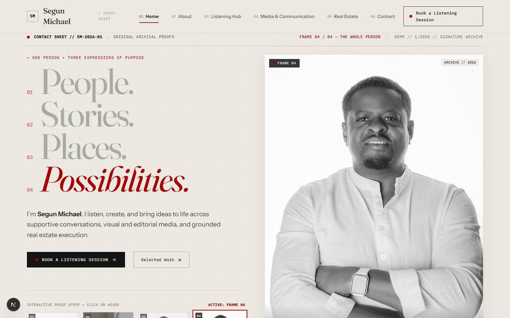

# Creative audit: the current homepage ("The Proof Sheet", round 2)

**Method.** I rendered the running site (`localhost:3000`, Next 16.4.4) in Edge at 1440×900 and 390×844, scrolled every section and took frame captures (see [`docs/research/current-*`](./research/)). I then read the section components to confirm what I saw. The round-1 audit and direction are archived in `docs/archive/round-1/`.

**Verdict.** Round 1 had no concept. Round 2 has a concept, but it is **worn as a costume**. "Contact sheet" was turned into labels: frame numbers, lens data, `// SM-2026-01`, monospace everywhere. It was never turned into an experience. Underneath the labels, the layout is the same template as before: a split hero, card rows, a dark band, a grid, a split CTA. It also brought back the **fabrications** that round 1 had removed, and added new ones.

| | |
| :-- | :-- |
| Desktop page | 9,127 px |
| Mobile page | **15,154 px (≈ 18 screens)** |
| Sections | 7, plus header and footer |
| Families | Fraunces, Instrument Sans, IBM Plex Mono, and Geist from the Next dev overlay |

---

## 1. Problems that disqualify it

### 1.1 It invents facts, again
The brief says: no fabricated claims. The rendered page shows:

| On screen | Where | Problem |
| :-- | :-- | :-- |
| `85MM // 1/250S // SIGNATURE ARCHIVE`, `35MM // F/2.0`, `85MM // F/2.8 // MAO CONTRACTORS` | [HeroProofSheet.tsx:42-64](../src/components/sections/HeroProofSheet.tsx#L42-L64) | Invented camera data, presented as fact. "MAO Contractors" attached to a studio portrait. |
| `CONTACT SHEET // SM-2026-01`, `ARCHIVE // 2026` | [HeroProofSheet.tsx:91](../src/components/sections/HeroProofSheet.tsx#L91), [:265](../src/components/sections/HeroProofSheet.tsx#L265) | An invented catalogue system. |
| `SAFE LIGHT // 60 MIN SESSIONS`, "60 dedicated minutes" | [DarkroomListeningSection.tsx:29](../src/components/sections/DarkroomListeningSection.tsx#L29), [:95](../src/components/sections/DarkroomListeningSection.tsx#L95) | An **invented service format** for the Listening Hub. |
| "Strictly confidential, completely non-judgmental…" | [DarkroomListeningSection.tsx:117](../src/components/sections/DarkroomListeningSection.tsx#L117) | An unconfirmed promise. Confidentiality is a commitment Segun must make, not the designer. |
| `year: "2024"` on every MAO image; `SLIDE 01 // MAO-WED-12` | [LightTableSection.tsx:24-64](../src/components/sections/LightTableSection.tsx#L24-L64) | Invented dates and codes on client work. |
| "ORIGINAL UNRETOUCHED ARCHIVE • LAGOS & INTERNATIONAL" | [LightTableSection.tsx:187](../src/components/sections/LightTableSection.tsx#L187) | Invented location claim, and "unretouched" is false (they are edited files: `-Edit`, `-2c`). |
| "Turning property potential into practical, **finished** reality." | [BlueprintRealEstateSection.tsx:41](../src/components/sections/BlueprintRealEstateSection.tsx#L41) | Implies completed real estate projects. This is explicitly forbidden. |
| "V&M Partnership Work", "Completed Commissions" | [work.ts:100-127](../src/data/work.ts#L100-L127) | Round 1 flagged this as unverified. It is still in the data. |

**Rule for round 3:** every word on the page must trace back to the brief or to Segun. Captions describe the photograph; they do not invent metadata.

### 1.2 The concept privileges one of the three expressions
"Contact sheet / darkroom / light table" is photography vocabulary. It makes the **Listening Hub a darkroom** and **real estate a blueprint pinned to a photo editor's table**. The brand idea is *one person, three equal expressions*. This concept says *a photographer who also does two other things*.

### 1.3 The hero is still a split template

- Headline left, portrait right, buttons under the text, a strip of thumbnails. It is the same skeleton as round 1, with labels added.
- **Three of the four headline words are ink at 30 % opacity on `#ECE9E3`**, about **1.9:1** contrast (measured in the rendered page). The words that *are* the brand are the least legible thing on screen.
- The portrait is a **box on an off-white page**. The processed web file's backdrop (≈ `#D3D3D3` at the corner of `public/images/portraits/segun-hero.jpg`) does not match the page (`#ECE9E3`), so you see a box edge instead of a person. The **original** (`potrait/IMG_2543c.jpg`) has a near-white backdrop (≈ 250), so the box was caused by the image processing, not the photography.
- The interaction (hover a thumbnail to swap the pose) is hidden in a strip labelled "INTERACTIVE PROOF STRIP — CLICK OR HOVER". When an interface has to explain itself, the idea isn't working.
- **14 distinct text styles in the hero alone, 10 of them monospace** (measured: family, size, weight, case and tracking combinations in the first viewport, excluding the header).

---

## 2. Section by section

| Section | What you see | What's wrong | Keep / discard |
| :-- | :-- | :-- | :-- |
| **Header** | SM monogram box, name in serif, "/ PROOF SHEET", six numbered nav links, a boxed booking CTA whose text wraps onto two lines | Numbered nav (`01 Home`, `02 About`) is decoration posing as information. The CTA wraps. "Home" in the nav of the home page. It is three ideas competing in 90 px. | **Discard**, except the instinct to keep booking always visible. |
| **Status bar** (`CONTACT SHEET // SM-2026-01 … 85MM // 1/250S`) | Monospace metadata line | Invented, and noise | **Discard** |
| **Hero** | See §1.3 | Split template, grey headline, boxed portrait | **Salvage:** the four words *People. Stories. Places. Possibilities.* are good. The arms-crossed portrait (IMG_2543) is the right primary image. |
| **Caption section** | Window portrait left, long serif paragraph right, three-column principles grid | The heading is a 30-word sentence set at 44 px, so it is a paragraph pretending to be a headline. The principles grid repeats the three pillars a second time. | **Discard** the layout. **Keep** the camera-at-window photo (IMG_1982c). It is the warmest image he has. |
| **Three expressions** | Three bordered cards with a photo, mono label, serif title, paragraph and link | *This is the moment the brand idea should come alive, and it is three cards.* The real estate card holds a portrait in a blazer, because there are no property images, and the composition can't hide that gap. | **Discard** completely. |
| **Darkroom / Listening Hub** | Near-black with a red glow; boxed B&W portrait; three icon cards ("Unhurried Time", "Reflective Clarity", "Total Discretion"); notice; CTA | The red "safelight" makes the most human offer look like a nightclub. **Icon cards** (clock, compass, shield) are the most generic pattern on the page, and two of the three make invented claims (§1.1). | **Keep** the idea that the Listening Hub gets its own atmosphere and a slower pace. **Discard** the darkroom metaphor, the icons and the claims. **Keep** the non-clinical notice. It is required. |
| **Light table / Media** | Six MAO photographs in equal bordered cards with fake slide codes | It is called a light table but built as a card grid, and the photos are shrunk inside borders and labels. Mobile stacks them as six full-width cards (≈ 5 screens). | **Keep** the photographs. Six MAO frames are genuinely strong. **Discard** the presentation. |
| **Blueprint / Real estate** | Text left, blazer portrait right, three mini-columns, CTA | "Finished reality" claim (§1.1). A grid background is the only "blueprint". | **Discard**. Real estate needs a genuinely different idea that is honest about having no project photos. |
| **Closing** | Close-up face left, headline right, two link-cards, two buttons | The fourth split layout on the page. Two buttons plus two cards means four CTAs at the end. | **Keep** the line *"Every meaningful connection begins with a conversation."* It is true to the brand. **Discard** the composition. |
| **Footer** | Name, nav columns, ventures list | Fine, generic | Rebuild as part of the new system. |

---

## 3. System-level diagnosis

**Typography.** Three families, each with too many jobs. Monospace was meant for captions and is now on buttons, labels, nav numbers, status bars and section tags. The italic red last word has moved from headings into the hero. Body text is fine. The display type has no conviction: it is Fraunces *light*, at moderate size, in grey.

**Colour.** Paper `#ECE9E3`, ink, one red: the restraint is right. But the section components reference the red **93 times** (dots, labels, numbers, borders, a glow), so it signals nothing. MAO red should be rare enough that it means "this is MAO" or "this is the one action".

**Photography.** Every photograph sits **inside a border, with a label, inside a card**. Nothing bleeds, overlaps, or is used at a scale that creates emotion. Jay Shetty puts one image across the whole screen. This site never does that once. The best images (the reaching hand IMG_2555, the camera at the window IMG_1982c) are used small or not at all.

**Layout and rhythm.** Every section is: eyebrow, then rule, then split or grid. Only the background colour changes. There is no change of *scale*, *density* or *tempo* between sections, so the page has no rhythm, only length. Mobile is 18 screens because nothing was redesigned for mobile; it was stacked.

**Motion.** Fades on enter, a hover swap in the hero, an auto-cycle. None of it carries meaning, and none of it is something you would describe to a friend.

**Storytelling.** The page says the same thing five times: three pillars in the hero copy, the caption grid, the cards, the darkroom and the closing cards. Repetition stands in for narrative. There is no *turn*, no moment where the visitor understands something they didn't before.

**Process.** The round-1 audit made correct promises ("italic appears once per section at most", "no invented claims", "fewer words") that the round-2 build broke. Round 3 needs a **checklist that blocks completion** (Stage 2), not intentions.

---

## 4. What survives into round 3

1. The four words: **People. Stories. Places. Possibilities.**
2. The positioning sentence: *"I'm Segun Michael. I listen, create and bring ideas to life across conversations, media and real estate."*
3. The closing line: *"Every meaningful connection begins with a conversation."*
4. **IMG_2543 / 2543c** (arms crossed) as the primary hero portrait.
5. The studio session as a *set* of gestures: clasped hands (2518), camera at window (1982c, 2040), blazer (2486/2487), pointing (2552), **reaching toward the lens (2555)**.
6. Six genuine MAO Media frames, plus more strong ones not yet used (`_MG_3015`, `wed13c`, `ma1 (5)`, `img_9800`).
7. MAO red **`#A70405`**, used rarely.
8. The non-clinical Listening Hub notice, and the rule *no journey section until real milestones exist*.
9. The stack: Next 16, GSAP 3.15 + `@gsap/react`, Motion, Tailwind 4. It is sound. The design failed, not the tooling.
