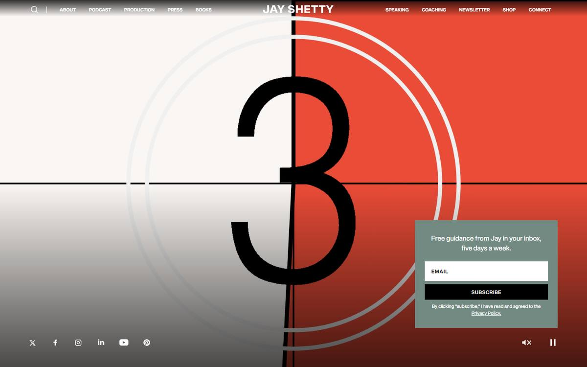
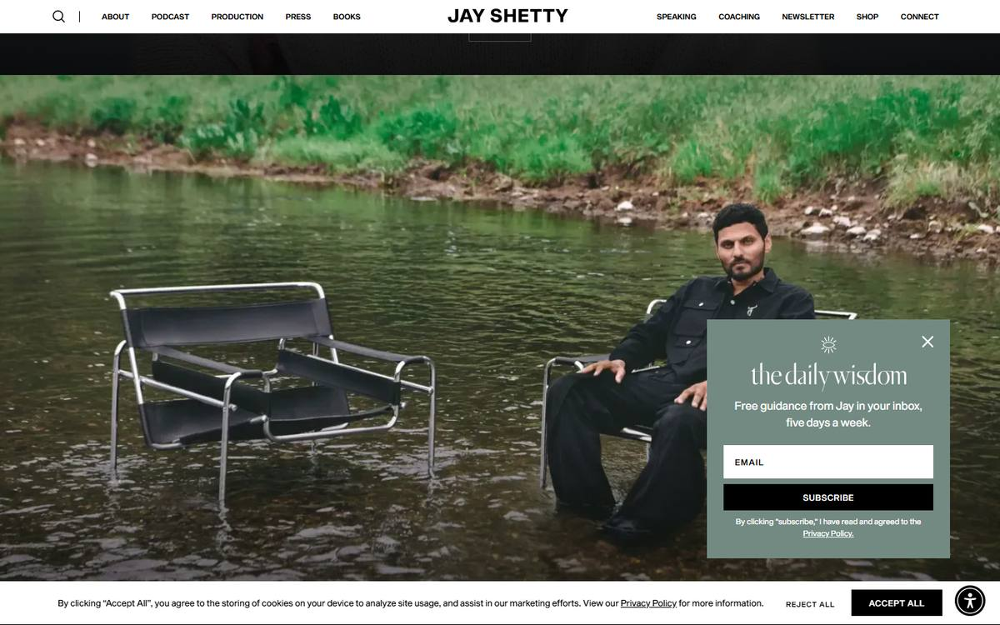
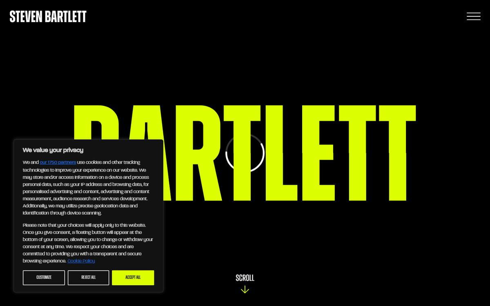
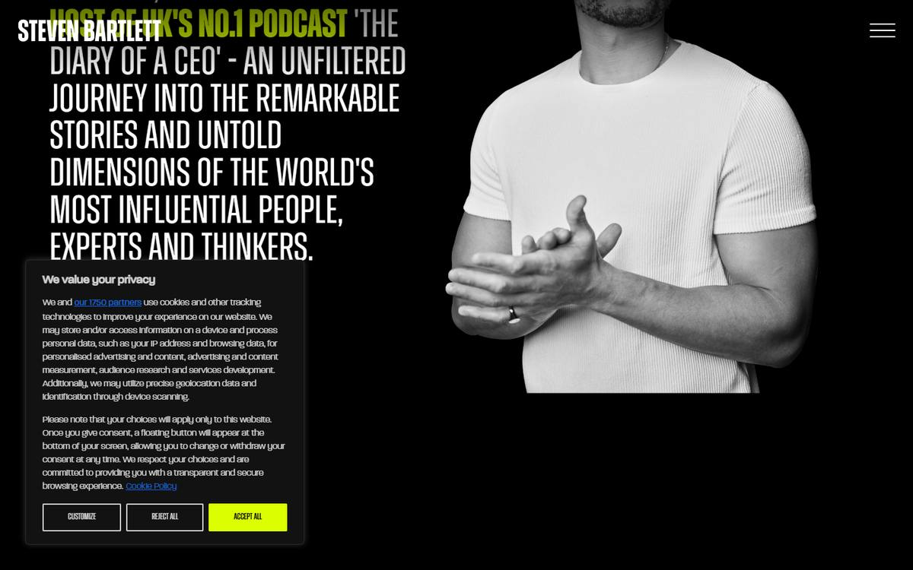
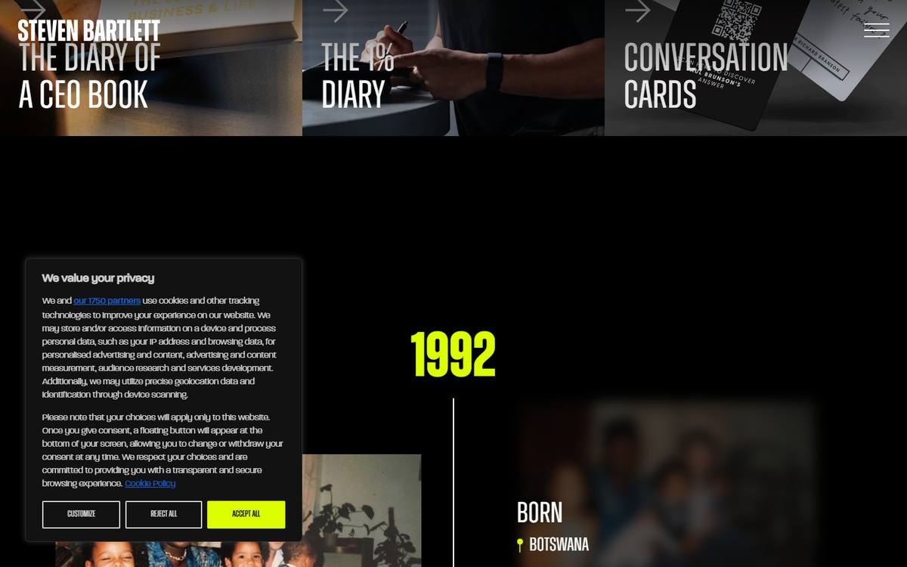
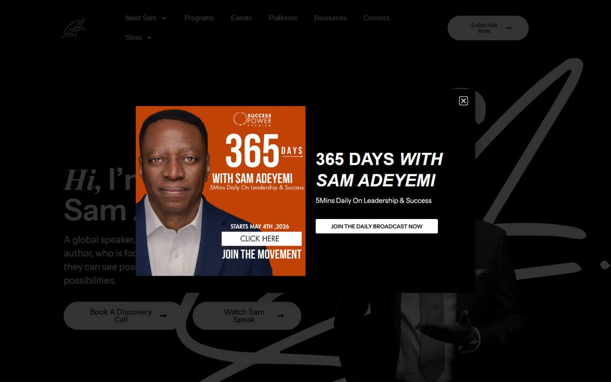
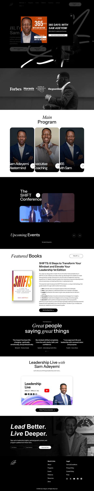

# Design reference analysis

**Method.** I drove real Microsoft Edge (headless, via playwright-core) through each live site on **2026-11-03** at **1440×900** and **390×844 with a mobile user agent**. For each viewport I captured the first view, scrolled the whole page in steps so lazy content and scroll animations fired, captured frames at 15 / 35 / 60 % of the page, and took a full-page shot. A script also extracted computed fonts, sizes, tracking, background colours, heading outline, navigation, calls to action and the platform used.

Screenshots are in [`docs/research/`](./research/).

**Limits, stated plainly:**
- I did **not** dismiss cookie banners or popups. They are left in, because they are part of the real first impression.
- Hover was tested on navigation only. I did not test every hover state.
- I watched autoplay video in frames, not as continuous playback.
- For Jay Shetty I studied the home page **and** `/about-jay`, because the storytelling the brief refers to lives there.

---

## 01 · Jay Shetty (jayshetty.me)

| | Observed |
| :-- | :-- |
| Platform | Webflow. No GSAP or Lenis detected; motion is Webflow interactions and video. |
| Type | **Sequel Sans** (uppercase nav and wordmark), **Gilda Display** (a soft, high-contrast serif, used only for warm, human sentences). |
| Palette | Black, white, and one muted **sage `#738A82`** used for every conversion surface. |
| Page length | 5,058 px desktop. The home page is essentially **five 100vh panels**. |

**Initial viewport.** A **film-leader countdown** ("3… 2… 1…") in cream and vermilion, then full-bleed video of him laughing on a TV set. Sound and pause controls are on screen. It is cinema, not a web page.

**Navigation.** Split around a centred wordmark: five items left, five right, all small uppercase. It is symmetrical and quiet, so the photography carries everything.

**Hero and image treatment.** One image fills each panel, with no text over the face. The portraits are **tight and filmic**: an extreme close-up against grey seamless with visible grain, a man in a chair *in a river*, and a reclining editorial pose on a carved bench. Each image is a **scene with an idea**, not a headshot.

**Narrative structure.** Each panel is one chapter of his world (podcast, production, press, books, speaking), labelled by **one small outlined button** placed low in the frame. The story is told by *images of him in different situations*. The copy is almost zero.

**Mobile.** A full-height video still of him from behind, and a hamburger. It is the same cinematic idea, and it holds up.

**What fails.** A newsletter popup, a newsletter bar *and* a cookie bar all sit over the first panels. Three conversion layers bury the art direction. The full-page screenshot is mostly black because the panels depend on video.

**What to learn for Segun**
1. **A personal brand can be told through situations, not adjectives.** Jay never writes "warm, curious, purposeful". He shows himself in a river.
2. **One image per screen, full commitment.** No collages, no frames around frames.
3. **One soft serif for the human voice**, separate from the functional type.
4. **Don't stack interruptions.** Segun needs one clear invitation, not three.

---

## 02 · Steven Bartlett (stevenbartlett.com)

| | Observed |
| :-- | :-- |
| Type | **Zuume** (ultra-condensed display, uppercase, 62–100 px+) for *everything*: nav, headings, timeline years, even CTAs. **Paralucent** for small body text. |
| Palette | Pure black, white, and **one acid lime `#DBFF00`**. Lime marks only what matters: name, years, active words, primary button. |
| Page length | 8,022 px desktop. |

**Initial viewport.** **"STEVEN" and then "BARTLETT" fill the screen in lime**, one word at a time, with a loading ring and "SCROLL ↓". There is no photo. The name is the hero. The only navigation is a hamburger.

**Introduction.** A black-and-white cut-out of him (white tee, hands mid-gesture) sits right. On the left, **his bio is set at display size**, and words switch from grey to white to lime as you scroll, so reading *is* the animation.

**Ventures.** Seven image tiles (podcast, fund, Dragons' Den, book, diary, cards), each with an **arrow and a condensed title over a dark photo**. It is the most conventional part of the site, rescued by the type.

**Journey.** "FROM HUMBLE BEGINNINGS", then a **centre-line timeline**: huge lime years (**1992 → 1994 → 2010**), a place pin, a short caption, and family photos that **sharpen from blur** as they reach the line. It is honest and specific, and dates make it credible.

**Then** DOAC (a wall of episode stills), a large conversation image, news and speaking enquiries.

**Mobile.** The cookie modal covers most of the first screen. Under it, the condensed type survives well at narrow widths, which is a real advantage of condensed faces.

**What to learn for Segun**
1. **A point of view is mostly typographic.** One face, one colour, used with total conviction. Nobody could mistake this site for a template.
2. **Make reading an event.** Scroll-highlighted text turns a bio into a performance.
3. **A journey needs real anchors.** Years, places and photographs. Segun has **not** supplied these yet, so a timeline would have to be invented. Rule: **no journey section until real milestones exist.**
4. **Caution:** a black-and-white cut-out over giant type is *Steven's* signature. Any direction that uses cut-outs must not look like this.

---

## 03 · Dr Sam Adeyemi (samadeyemi.com)

| | Observed |
| :-- | :-- |
| Platform | WordPress + Elementor. |
| Type | **Instrument Sans** 500–600 for headings (70 px), **Playfair Display italic** for single words ("*Hi,* I'm", "*Great* people", "Leadership Live *with*"). Font Awesome icons. |
| Palette | Black, white, greyscale photography. Colour enters only through promotions. |
| Page length | 7,429 px desktop. |

**Initial viewport.** A black field with his **signature mark drawn enormous** behind a black-and-white portrait. On the left: "*Hi,* I'm Sam Adeyemi", a one-sentence positioning ("A global speaker, author, who is focused on…") and **two pill CTAs: Book A Discovery Call / Watch Sam Speak**. A promotional modal for "365 Days" covers the hero on load, on desktop *and* mobile.

**Information hierarchy** (the clearest of the three):
1. Who he is, plus two actions
2. **Credibility strip** (Forbes, Horasis, WEF, The Guardian) over a portrait
3. **"Main Program"**: three portrait cards (Mastermind, Executive Coaching, 365 Days), each with ↗
4. Flagship conference
5. Events
6. Books
7. Testimonials
8. Show
9. Newsletter ("*Lead Better.* Live Deeper.")
10. Footer

**Navigation.** Meet Sam ▾, Programs, Events, Platforms, Resources, Connect, Store ▾, plus a "Subscribe Now" pill. It is explicit and transactional.

**What fails visually.** The italic-word-plus-sans heading formula repeats on every section. Cards are uniform rounded portraits. The popup is hostile on mobile. It is conversion-competent and art-direction-generic.

**What to learn for Segun**
1. **Say what you do in one sentence, then give two doors.** Segun's two doors are already defined: *Book a Listening Session* (primary) and *See the work* (secondary).
2. **Name every offering explicitly.** A visitor must be able to say "Listening Hub, MAO Media / Inspire Network, MAO Contractors" after one scroll.
3. **A personal mark can carry identity** (Sam's signature). Note: older work in Segun's archive is signed *"Michael Adebiyi Photography"*. Whether a signature belongs to his current identity is **a question for you, not a design assumption.**
4. **Credibility must be real.** Sam's press logos and testimonials are genuine. Segun has none supplied, so there will be **no logo strip and no testimonials**, and the layout must not leave holes where they would go.

---

## Synthesis: what to take, and what not to

| Principle | From | Applies to Segun as |
| :-- | :-- | :-- |
| Tell identity through **situations** | Jay | His studio session already shows him in different gestures, behind a camera, at a table. Use those as scenes, not as card thumbnails. |
| **One typographic conviction** | Steven | One display face used with nerve, plus one accent colour. Not three families with every style each. |
| **Reading as an event** | Steven | One scroll-performed passage, not every paragraph. |
| **Explicit offers, two doors** | Sam | The hero must say the three areas plainly and offer *Book a Listening Session* plus one secondary path. |
| **Honest anchors** | Steven (timeline), Sam (press) | Only when real. Leave out the journey and testimonials until supplied. |
| **Don't bury the art under popups** | All three fail this | No modals. One quiet booking path that is always available. |

**What none of them does, and where Segun can stand apart:** all three treat the ventures as a *list of products*. None of them makes the **connection** between the ventures the subject of the design. Segun's brand idea, "one person, three expressions", *is* that connection. If the experience performs the connection rather than listing three boxes, it will be distinct from all three references.
