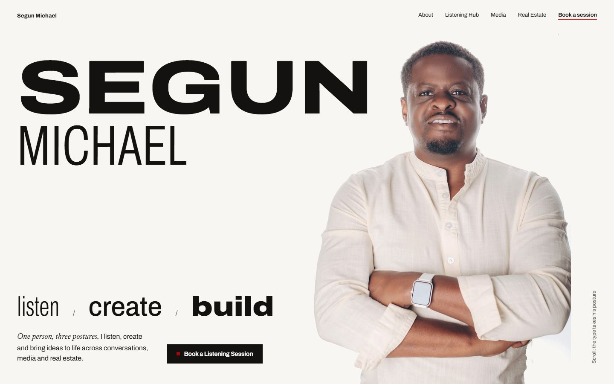
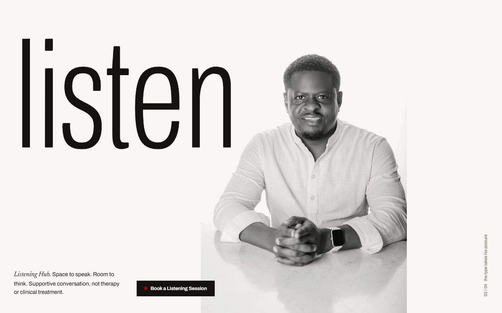
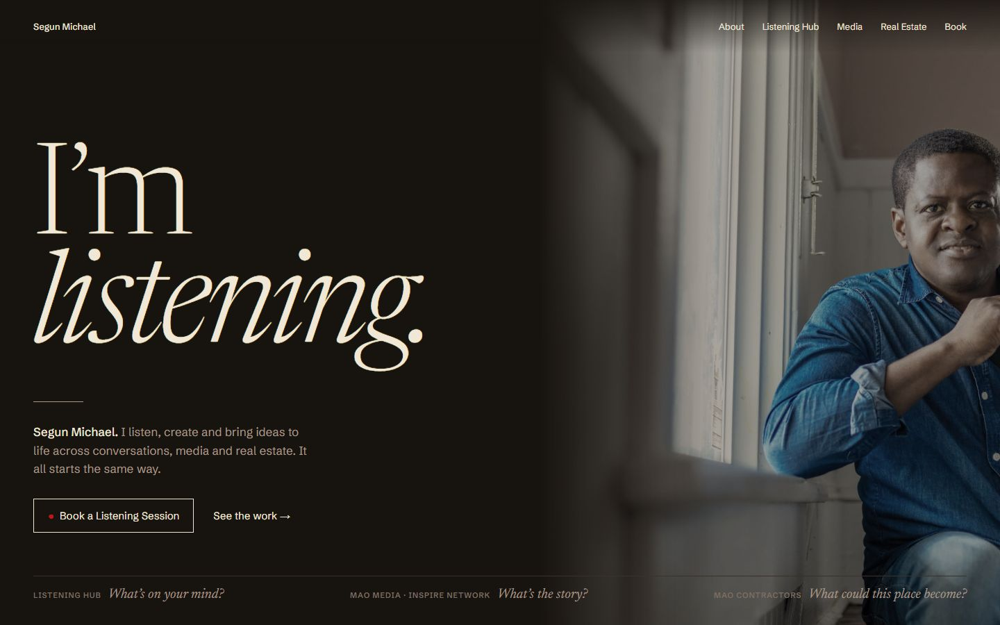
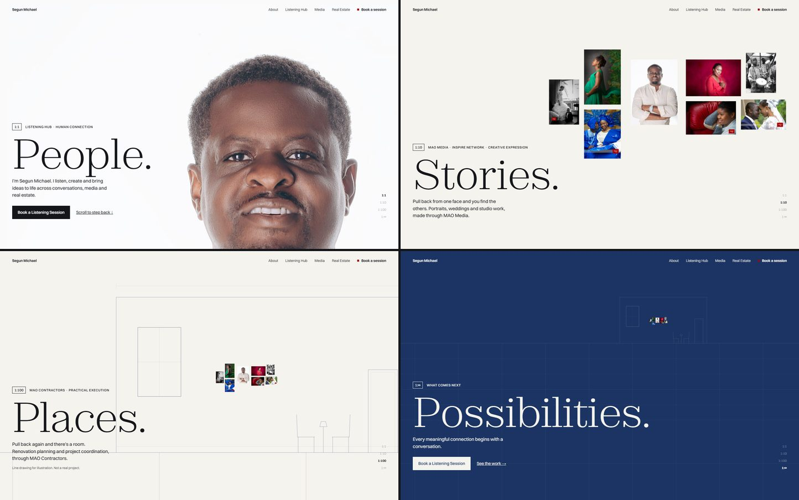
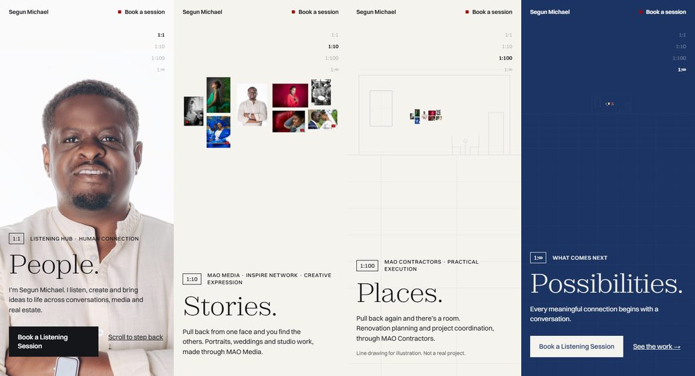
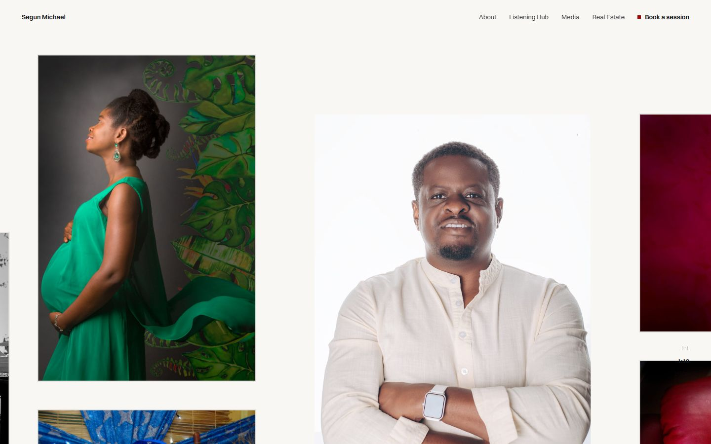
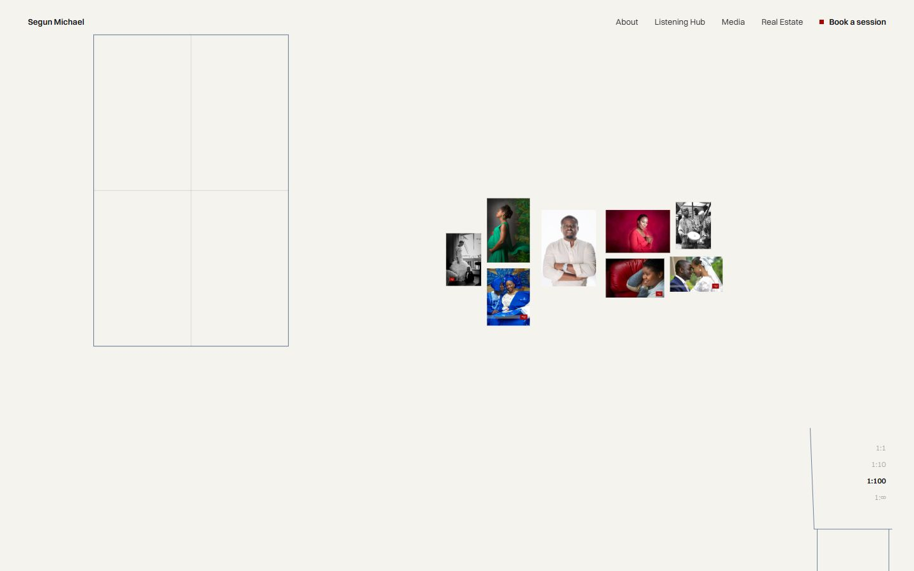
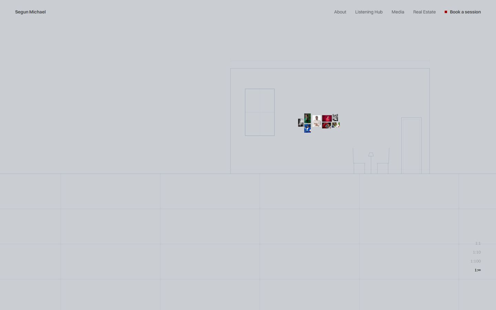

# New creative direction: three concepts and a recommendation

**Status: Direction C approved (2026-11-03) and implemented.** See [IMPLEMENTATION_REPORT.md](./IMPLEMENTATION_REPORT.md) and [DESIGN_SYSTEM.md](./DESIGN_SYSTEM.md). This document is kept as the record of the Stage 1 thinking.

What sits behind this document:
- [CREATIVE_AUDIT.md](./CREATIVE_AUDIT.md): why the current site fails
- [DESIGN_REFERENCE_ANALYSIS.md](./DESIGN_REFERENCE_ANALYSIS.md): Jay Shetty, Steven Bartlett, Sam Adeyemi
- [SKILLS_RESEARCH_AND_APPLICATION.md](./SKILLS_RESEARCH_AND_APPLICATION.md): what was read and how it is used

**Comps.** Every image below is a **rendered HTML comp built from Segun's real photographs**, not a mood board. To try them yourself, open the files in a browser:

| File | What it is |
| :-- | :-- |
| [`docs/concepts/a-body-language.html`](./concepts/a-body-language.html) | Static hero plus one section |
| [`docs/concepts/b-room-to-speak.html`](./concepts/b-room-to-speak.html) | Static hero |
| [`docs/concepts/c-near-to-far.html`](./concepts/c-near-to-far.html) | **A working scroll prototype. Scroll it.** It uses plain JS (`requestAnimationFrame`) so it opens straight from disk; production would use GSAP ScrollTrigger. Add `?p=0` … `?p=3` to the URL to freeze a frame. |

Round 1 and 2 material is archived in `docs/archive/round-1/`.

---

## 0. What the material actually allows

These facts constrain every idea more than taste does.

1. **One studio session, many gestures.** On near-white seamless (measured ≈ 245–252 RGB) he is shown arms crossed (2543 / 2543c), hands clasped at a table (2518), pointing at the lens (2552), **reaching toward the lens (2555)**, in a blazer (2486 / 2487), and behind a camera at a window (1982c, 2040). It is a vocabulary of postures, all with the same light.
2. **He is a working photographer.** About 60 gallery files: portraits, weddings, studio, cultural, documentary, and **commercial product work**. Some older frames are signed **"Michael Adebiyi Photography"**.
3. **One real brand colour:** the MAO red square, `#A70405`.
4. **No real-estate photography exists.** Real estate can only be shown through him, words, or clearly illustrative drawing.
5. **No dated milestones, press or testimonials** have been supplied, so there will be no timeline, no logo strip and no quotes.

---

## A · Body Language
### *The type takes his posture.*

| | |
| :-- | :-- |
| **Central concept** | One body, three postures. Each expression is a gesture he really made in the session. **Listen** = hands clasped, leaning in. **Create** = camera to eye. **Build** = arms crossed in a blazer. **Invite** = the hand reaching toward you. The typography physically takes each posture: the same typeface, on a variable *width* axis, goes tall and narrow for *listen* and wide and heavy for *build*. |
| **Visual identity** | The page *is* his studio backdrop: seamless off-white `#F7F6F3`, ink `#141210`, MAO red used once per screen. He stands directly on the page, never boxed. |
| **Typography** | **Archivo** (variable: width 62–125, weight 100–900, OFL) for everything. One family whose *width* carries meaning. **Newsreader Italic** for whispered asides only. |
| **Colour** | Seamless, ink, MAO red, plus skin-warm shadows from the photography. Contrast: ink 17.3:1, muted `#5E5852` 6.5:1, red 7.3:1. |
| **Photography** | Full-height studio figures. Each section is one gesture at life scale. **Needs proper cut-outs** (see risks). |
| **Hero** | The name split across two widths (SEGUN expanded and heavy, MICHAEL condensed and light) beside the arms-crossed portrait. *listen / create / build* is set in three different widths. |
| **Layout** | Every section is one figure plus one word at enormous scale, and the composition changes because the posture changes. |
| **Interaction and motion** | As you scroll, the word's width and weight tween into the next posture (GSAP on `font-variation-settings`) while the figure cross-dissolves between gestures shot in identical light, so it reads like stop-motion of one man. Hover over a verb previews its posture. |
| **Why it suits Segun** | It is built entirely from *him*: his body, his session, his warmth. |
| **What makes it memorable** | Typography that changes shape with a person's body language. I haven't seen a personal site do that. |

**Risks.**
- The composition, a person beside giant type, is **too close to Steven Bartlett's** signature. The light ground and colour soften the resemblance but don't remove it.
- The figures must be **cut out** (background removal) to sit on the page without boxes. You can see the problem in the table photo above. Cut-outs are a retouch, so they need your permission.
- On mobile, body copy runs over the figure. That is unresolved in the comp.
- The width-shifting type risks becoming the whole idea: it is **a style more than a structure**.

---

## B · Room to Speak
### *A site that listens before it talks.*

| | |
| :-- | :-- |
| **Central concept** | Listening is the root of all three expressions. You listen to a person (Listening Hub), to a story (MAO Media / Inspire Network), to a place (MAO Contractors). The site *behaves* like a good listener: it says one thing, then leaves room. The hero headline is **"I'm listening."** Each expression is introduced as the question he would ask: *What's on your mind? What's the story? What could this place become?* |
| **Visual identity** | An evening room: warm near-black `#17130F`, lamp-cream type `#F1E7D6`, photographs lit as if by one lamp. Huge silence around very few words. |
| **Typography** | **Newsreader** (variable optical size 6–72, real italics) set very large and light: a voice, not a headline. **Schibsted Grotesk** for facts and UI. |
| **Colour** | Room, lamp, a dim taupe `#A8998A` (6.7:1). MAO red only as the booking dot. Red on the room is 3.05:1, so it is acceptable as a graphic mark but never as text. Small labels need lightening: `#7D6F62` fails at 3.8:1. |
| **Photography** | Environmental, not studio: the window portrait (1982c), the clasped hands, MAO frames shown one at a time, full-bleed, like being handed a print across a table. |
| **Hero** | "I'm *listening.*" fills the left. Segun at the window fades out of the dark on the right. The three questions run along the bottom as the navigation. |
| **Layout** | One idea per screen, with long pauses. Sections are conversations: a question, his short answer, one image, one action. |
| **Interaction and motion** | Text arrives line by line at speaking pace (SplitText, once only). A hairline "breath" mark separates turns. Nothing moves while you read. |
| **Why it suits Segun** | It puts the Listening Hub, the primary conversion, at the emotional centre, and makes a virtue of having few claims. |
| **What makes it memorable** | Being addressed. "I'm listening." is the most human first line any of these sites could have. |

**Risks.**
- It is **the weakest showcase for his photography**, which is his most concrete proof of craft.
- It would read as a **Listening Hub website with two attachments**, the opposite of "three equal expressions".
- Dark editorial minimalism is well-trodden. Its quality depends almost entirely on copy, which has to be written and approved with Segun.

---

## C · Near to Far  ★ recommended
### *One attention, four distances.*

| | |
| :-- | :-- |
| **Central concept** | **People. Stories. Places. Possibilities.** are not four words. They are **four distances from the same person.** At **1:1**, you are face to face: listening, *people*. Step back to **1:10**: his portrait is one print among the people he has photographed, *stories*. Step back to **1:100**: the prints hang on the wall of a room, drawn in line, with two chairs facing each other, *places*. Step back to **1:∞**: the room is a small drawing on open ground under a deep blue, *possibilities*. The three expressions become **one continuous act of attention at different scales**, which is exactly "one person, three expressions". |
| **Visual identity** | **Cyanotype.** The sun-print process is both a *photographic* process and the origin of the architectural *blueprint*, so it belongs to media and to building at once. The page starts on the white of his studio backdrop, settles to paper `#F5F3EE`, and at 1:∞ exposes to **Prussian blue `#1B3463`**, with the drawing turning white. MAO red marks only the booking action, and only on paper. |
| **Typography** | **Zodiak** (Fontshare, variable, sharp-shouldered serif) for the four words and a few statements, very large and light. **Switzer** (Fontshare) for text. **Scale ratios `1:1 · 1:10 · 1:100 · 1:∞` in tabular figures** replace round 2's fake camera metadata. It is a real drafting convention used to mean something. **No monospace anywhere.** |
| **Colour** | White of the studio backdrop, paper, ink `#14161A` (16.3:1), Prussian blue (11:1 both ways), MAO red (7.1:1 on paper). **Rule: red never on blue (1.55:1).** On blue, the CTA inverts to paper. |
| **Photography** | Used at its true meaning, by scale. The **primary portrait (IMG_2543c)** is the 1:1 face and the 1:10 print. The **genuine MAO Media frames** hang beside it. The **reaching hand (2555)** closes the page. **Not one image is fabricated.** The room is an elevation drawing with no dimensions or figures, labelled "Line drawing for illustration. Not a real project." **No cut-outs needed.** |
| **Hero** | Opens face to face with Segun, filling the right two-thirds. On the left: "1:1 · Listening Hub", **People.**, the positioning sentence and *Book a Listening Session*. The scroll then pulls the camera back through the four scales. In production the first frame is server-rendered and complete without JavaScript. The prototype doesn't do this yet. |
| **Layout** | After the pull-back, the page **walks back in** and gives each scale its own composition (§5). Sections differ because their *distance* differs, not because their background colour does. |
| **Interaction and motion** | **One verb: the camera.** It pulls back and pushes in. A line drawing that draws itself is the only other motion, plus a print that lifts on hover or focus. Everything else is still. The scale ruler is both a progress indicator and the homepage's section navigation. |
| **Why it suits Segun** | It treats the three expressions as *one way of paying attention*, which is the brand idea. It is built from his actual archive. It is honest about real estate (a drawing, not a fake project). It gives the four approved words a structural job instead of decorating a hero. |
| **What makes it memorable** | You start eye to eye with a person and scroll back until he's a mark on the horizon. Then the page brings you back to his hand reaching toward you. That is one sentence you could describe to a friend. |

*Mobile (390 px): the same four frames. The idea is orientation-independent, so it survives on a phone, unlike a split or triptych layout.*

**Risks, and how the prototype answers them**

| Risk | Status |
| :-- | :-- |
| Scroll-scrubbed zoom feels like a tech demo | Mitigated by having one verb only, about four screens of scrolling, and real content at every rest point. The prototype's in-between frames (below) look intentional, not glitchy. |
| Performance on mid-range phones | The prototype uses only `transform` on a single layer. A high-res face layer swaps in near 1:1, and SVG strokes are non-scaling. **This must be measured on a real mid-range Android in Stage 2.** If it fails, the fallback keeps the four compositions as stepped (not scrubbed) transitions. The concept survives; only the continuity is lost. |
| Motion sensitivity | `prefers-reduced-motion` gives four still frames with short cross-fades and no scrub. Scroll is never hijacked; the page scrolls natively. |
| The drawing could be read as a real project | No dimensions, no address, no "completed". It is labelled, and it depicts *a room for conversation*, not a development. |
| "Powers of Ten" association | The technique (a continuous scale journey) is common cinematic grammar. Nothing is borrowed: no exponents, no aerial photography, no picnic. The structure comes from Segun's own four words. |

In-between frames (scroll positions 0.5, 1.5 and 2.5 of 3):

*Known prototype flaw: frame 2.5 passes through a greyish blend while the paper exposes to blue. In production this becomes an "exposure" wipe, not a colour mix.*

---

## Directions considered and rejected before these three

| Idea | Why it was rejected |
| :-- | :-- |
| **Proof Sheet, executed better** (keep round 2's idea) | Its problem isn't execution; the idea itself puts photography above the other two expressions. |
| **Three Rooms** (round-1 concept C, a triptych) | It reads as three businesses with a person pasted on, and it collapses on mobile. C keeps its one good instinct, environments, but as *distances*, not *departments*. |
| **Issue 01** (a magazine cover) | A known trope that suits Media only. |
| **Signature** (a giant personal mark, like Sam Adeyemi's) | It imitates a reference, and the only signature in the archive ("Michael Adebiyi Photography") is unconfirmed as his current identity. |
| **Lagos street-poster / hand-painted signage** | It would assume a cultural and geographic identity nobody has confirmed. Round 2 had already invented "Lagos" once. |
| **WebGL portrait distortion / particles** | Technology looking for a reason. It would make a warm man feel like a product launch. |

---

## Evaluation

Scored 1–5. Honesty is weighted as a gate, not a bonus.

| Criterion | A · Body Language | B · Room to Speak | **C · Near to Far** |
| :-- | :-: | :-: | :-: |
| Originality | 4 (strong type idea; Steven-adjacent composition) | 3 | **5** |
| Brand relevance: unites the three as one | 3 (three gestures, side by side) | 3 (Listening dominates) | **5** (one act, three distances) |
| Visual quality, from the comps | 4 | 4 | **4** (5 once the 2.5 transition is resolved) |
| Usability and conversion | 4 | 4 | **4** (CTA in frames 1 and 4, plus header) |
| Technical feasibility | 4 (cut-outs needed) | 5 | **3** (needs device testing) |
| Honesty with the assets | 4 (retouching) | 5 | **5** (no retouch, labelled drawing) |
| Mobile | 3 | 5 | **4** |
| **Total** | 26 | 29 | **30** |

B scores close to C on paper because it is safe and easy. I don't recommend it, because **"easy and safe" is how rounds 1 and 2 ended up generic.** C is the hardest of the three and the only one whose *structure* is the brand idea.

---

## 5. If approved: the homepage narrative for C

The page **pulls back, then walks back in.** Each section is defined by its distance.

| # | Section | Distance | Composition (each one different) |
| :-- | :-- | :-- | :-- |
| 00 | **Header** | | Name left; About · Listening Hub · Media · Real Estate; **Book a session** with the red square. Nothing numbered. The scale ruler on the right is the homepage's index. |
| 01 | **The pull-back** (hero) | 1:1 → 1:∞ | As prototyped. About 4 screens on desktop, about 3 on mobile. All four chapters exist in the DOM as real headings, so a screen reader and a no-JS visitor get the whole story. |
| 02 | **Listening Hub** | 1:1 again | The closest, quietest section. Hands-clasped portrait (2518) cropped to the hands and face, full height, on the studio white. Short lines that reveal at reading pace: **the one "reading as an event" moment on the page** (the Steven lesson, used once). "Space to speak. Room to think." The non-clinical notice in plain words. Primary CTA. |
| 03 | **Media & Communication** | 1:10 | The salon wall becomes a real, browsable wall of genuine MAO Media frames at varied sizes. Drag or scroll horizontally; prints lift on hover or focus with a factual caption (*wedding portrait*, *studio portrait*), with **no invented dates or codes**. Camera-at-window (1982c) as the person behind the work. Inspire Network named as an editorial platform, with no podcast claims. |
| 04 | **Real Estate** | 1:100 | Cyanotype: the room's elevation **draws itself** as you arrive (the only line-draw on the page). Blazer portrait (2486) beside it. Copy limited to what is confirmed: renovation planning and project coordination through MAO Contractors. The illustrative label is always visible. |
| — | **Journey** | | **Omitted until Segun supplies real milestones.** The scale structure can later host a timeline whose distances are years. |
| 05 | **Closing** | back to 1:1 | The bookend. The reaching hand (2555) fills the screen, coming toward you through the lens: *"Every meaningful connection begins with a conversation."* plus **Book a Listening Session**. |
| 06 | **Footer** | | Set like a drawing's **title block**: name, the four ventures (Listening Hub, MAO Media, Inspire Network, MAO Contractors), links, credit. It is a drafting convention used honestly. |

**Motion system.** These are the only permitted motions, per the ui-ux-pro-max rule of one or two animated elements per view:

| Motion | Engine | Rules |
| :-- | :-- | :-- |
| The camera | GSAP ScrollTrigger, scrubbed | Log-scale interpolation, transform only, on native scroll |
| The line-draw | GSAP, `stroke-dashoffset`, once | |
| Line reveal (Listening section only) | GSAP SplitText, once | |
| Print lift | Motion for React, spring | On hover or focus |

Each has a `gsap.matchMedia()` branch for desktop, mobile and reduced motion. There are no fades-on-scroll for ordinary content.

**Performance plan.**
- The hero face is the LCP element: a server-rendered `<Image priority>` in AVIF, never revealed by JS.
- The GSAP scene loads with `next/dynamic` after paint.
- MAO prints are lazy-loaded; the high-res face layer is used only near 1:1.
- Budgets: JS < 300 KB, above-fold images < 500 KB, fonts < 100 KB (two self-hosted variable families, subset).
- Measured before and after with Lighthouse and a trace.

**Accessibility plan.**
- WCAG 2.2 AA contrast (pairs listed above).
- Focus is visible and never hidden under the sticky header.
- The ruler is a `nav` with `aria-current`. Keyboard users can jump between scales.
- No content exists only inside the animation.
- Reduced-motion version as described in the risks table.

**Stage 2 acceptance gate** (blocks "done", because round 2 broke its own promises):
1. Every sentence traces to the brief or to Segun.
2. No monospace, and no invented metadata.
3. Screenshots at 375 / 768 / 1024 / 1440 have been reviewed for every section.
4. Reduced-motion pass.
5. Measured performance numbers.
6. Mid-range Android test of the pull-back.

---

## 6. Decisions I need from you

1. **Direction.** Approve **C · Near to Far**, or choose A or B.
2. **Hero portrait.** I've taken "the portrait named potrait" to mean the arms-crossed **`potrait/IMG_2543c.jpg`** (colour), as the round-1 notes recorded. Please confirm, or name the file. The other candidates are `IMG_2543.jpg` (mono) and `propfie.jpg` (square, mono, blazer).
3. **"Michael Adebiyi Photography".** Several older gallery images carry this signature. Is it Segun's earlier name or studio, and may that work be shown as his?
4. **Commercial work.** Coca-Cola, Orijin, Charles Tyrwhitt, Leatherworld and Peniel images are in the gallery. Were these his commissions, and may they be shown with the brand names? (For now they are excluded.)
5. **New copy.** C introduces short lines: "Pull back from one face and you find the others…", "Pull back again and there's a room…". These are descriptions, not claims, but they speak for him. Approve them, or have Segun supply his own.
6. **Fonts.** Zodiak and Switzer come from Fontshare (ITF Free Font Licence, which allows commercial web use; I will re-check the licence text before shipping and self-host the files). If you'd prefer Google Fonts only, the fallback is Newsreader with Hanken Grotesk.
7. **Skills install.** Installing `vercel-react-best-practices`, `accessibility`, `performance` and `core-web-vitals` was blocked by the permission system. Their rules are already applied from reading them. Approve the install if you want them to load automatically in future sessions.
