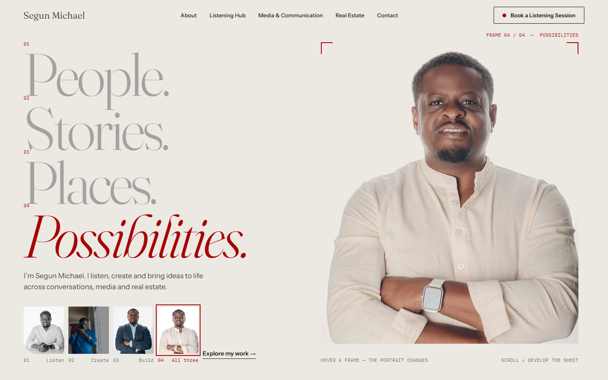
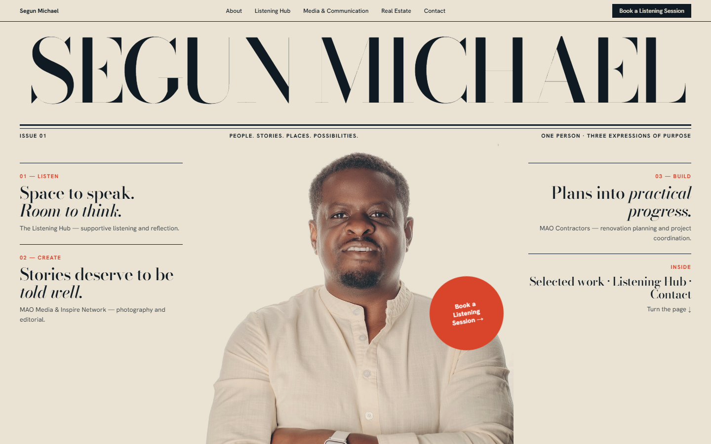
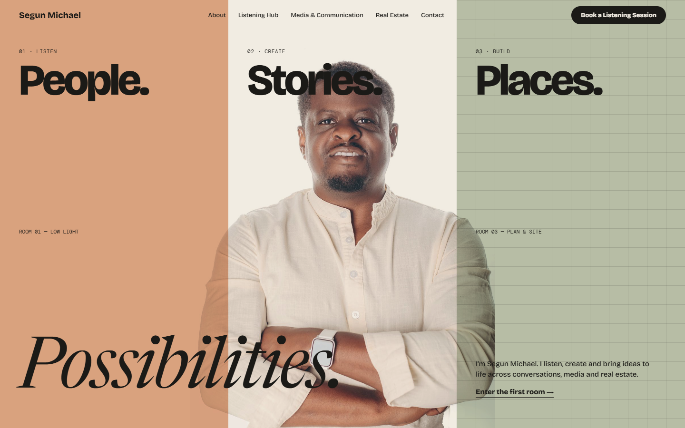

# New Creative Direction — three concepts for review

**Status: awaiting approval. No implementation has started.** The comps referenced here are static design sketches built from your real photographs (`docs/concepts/`). They are not production code.

---

## 0. Research (what I actually did)

I ran web searches on Locomotive, Active Theory / Immersive Garden / Dogstudio, and Awwwards‑level photographer portfolios, and read the summaries. **I did not visit or interact with those sites**, so I'm drawing principles, not copying execution. The principles that mattered:

- **The interface performs a metaphor** (Locomotive's "rolling train" of sections, Dogstudio's shape‑shifting subject). The concept is built, not described.
- **Atmosphere over layout.** Colour, light and typography are chosen to serve one emotional intent; negative space and one dominant move direct the eye.
- **Photography‑first portfolios** treat the screen like a print object: a typographic statement or a single decisive image opens; rhythm alternates scale; captions and metadata behave like print furniture; restrained interaction supports the work.
- **Scroll as progression, with fallbacks** (smooth scroll, pinned/sticky moments, reduced‑motion and performance discipline).
- **Technology serves the story.** WebGL is justified only when the concept needs it. Nothing here does.

Skills read for this phase: `ui-ux-pro-max` (previously run; its "Liquid Glass" recommendation is rejected as generic), `gsap-scrolltrigger`, `motion-framer`, `modern-web-design` (read earlier this project). I did not install anything new; the existing stack covers every concept below.

---

## 1. Constraints that shape every idea (from the real assets)

- Segun has a **full studio shoot of himself on white seamless**: arms crossed, hands clasped, pointing at the lens, reaching toward the lens, in a blazer, behind a camera. Several poses of one person in one session is a **contact sheet waiting to happen**.
- He is a **photographer** (MAO Media). The MAO mark is a **red** square (`#A70405` sampled). That is the one real brand colour.
- His commissioned work is saturated and dramatic: red, green, blue. The current beige palette contradicts it.
- **There are no real‑estate photographs.** No concept may fake them. Real Estate has to be expressed through him, type and drawing, never fabricated buildings.
- His studio backdrop is white, not perfectly. A hard **cut‑out (matte)** would enable type to pass _behind_ him (real depth), but it is a retouch of the photograph and I want your permission first (see Decisions).

---

## 2. Concept A — **The Proof Sheet**

1. **Central idea.** Segun is a photographer, and the whole site is a contact sheet he is editing. _Choosing where to look is the common act across all three expressions:_ listening is giving someone your attention; a photograph is a decision about attention; a building plan is attention made physical. The same shoot produces four frames, one per word: **People · Stories · Places · Possibilities**.
2. **Visual identity.** Paper (`#ECE9E3`, neutral like his backdrop), ink (`#141414`), **one signal colour: MAO red** used like a photo editor's grease pencil: crop marks, frame counters, the selected frame. A dark "darkroom" passage (near‑black with a faint red safelight glow) for the Listening Hub.
3. **Typography.** _Fraunces_ (light, optical size 144, with its true italic) for display: high‑contrast, warm, distinctive. _Instrument Sans_ for text. _IBM Plex Mono_ **only** for frame numbers and captions, never for paragraphs. Three families, each with one job.
4. **Image treatment.** Studio portraits sit **directly on the paper**, no card, no border. Their backdrop multiplies away, with crop marks marking the frame. MAO work appears at varied scales like prints on a light table, not as equal tiles. Only genuine frames are used; no invented camera data.
5. **Homepage composition.** Hero: four‑line headline left; one very large frame right bleeding to the edge; a four‑frame strip beneath, each frame bound to a word. A fixed frame counter (`01 / 07`) tracks scroll. Sections are "frames" with their own compositions (see §7).
6. **Interaction & motion.** Hovering/focusing a word or thumbnail swaps the big portrait to the matching pose (crossfade with a short contact‑sheet "advance"); on load the words auto‑cycle once, then rest on the arms‑crossed frame. Scroll advances the "sheet": crop marks travel, the counter ticks, the Listening Hub section fades the paper to darkroom. Cursor over images becomes a small viewfinder (desktop only).
7. **Why it suits him.** It is built from _his_ photographs, his craft and his brand red. No one else can make this site. It expresses one person in several roles without separating them into businesses.
8. **Distinctive because** the navigation of the page _is_ the portfolio idea; the hero is an interaction, not a picture; and the headline words function as an index to the poses.

**Risks.** Needs the real pose images curated carefully; can feel cold if not warmed by the portraits' expressions; cursor and cycling must be optional and accessible. The static fallback shows the full hero with no motion.

---

## 3. Concept B — **Issue 01** (the cultural journal)

1. **Central idea.** The homepage is the cover of a publication about one person: masthead, cover lines (one per expression), an "Inside" index. Sections turn like spreads.
2. **Visual identity.** Newsprint (`#EAE3D4`), ink navy (`#0F1A22`), a vermilion accent (`#D8452B`).
3. **Typography.** _Bodoni Moda_ (didone masthead + italic deck lines) with _Hanken Grotesk_. High drama at scale.
4. **Image treatment.** Single hero portrait, centred, cover‑style; section "stories" as photo essays.
5. **Composition.** Masthead across the top (SEGUN MICHAEL at full width), portrait centred, cover lines left/right, a rotated vermilion roundel as the booking CTA.
6. **Motion.** Page‑turn style section transitions; masthead resolves on load; hover reveals "pull quotes".
7. **Why it suits him.** Inspire Network is an editorial platform, so a publication frame fits the media pillar.
8. **Distinctive because** it is bold and legible at a glance.

**Risks.** It is a known trope (the "Kinfolk cover"), and it suits Media better than Listening or Real Estate. In my comp the Bodoni hairlines break up at display size (a type‑tuning problem), and true "type behind the head" depth would require the matte. Less anchored in Segun's specific material than A.

---

## 4. Concept C — **Three Rooms** (the walk‑through)

1. **Central idea.** One person, three environments. The page is a corridor of three rooms, each with its own atmosphere and palette, joined by one constant figure.
2. **Visual identity.** Clay (low‑light, listening) · bone (the studio, creating) · sage with survey grid (site, building).
3. **Typography.** _Bricolage Grotesque_ at heavy weight for big words, _Newsreader_ italic for the whisper, _DM Mono_ for annotations.
4. **Image treatment.** The same portrait multiplied across three colour fields so his shirt takes each room's tint.
5. **Composition.** Triptych hero: three vertical fields, one word each, Segun straddling them, "Possibilities." across the base.
6. **Motion.** Scroll‑pinned room transitions; fields wipe; the grid draws itself in the Build room.
7. **Why it suits him.** Most literal expression of "three expressions, one person."
8. **Distinctive because** the tinted‑shirt triptych is instantly memorable.

**Risks.** Highest risk of reading as _three separate businesses_ with a person pasted on top; the Build room has **no real imagery**, so it leans on drawings and grids; most complex to build and keep fast; in my comp the "Stories." lettering collides with his head. Mobile reduces the triptych to a stack, losing the idea.

---

## 5. Critical comparison

| Criterion                    | A · Proof Sheet                                           | B · Issue 01                 | C · Three Rooms                         |
| :--------------------------- | :-------------------------------------------------------- | :--------------------------- | :-------------------------------------- |
| Originality                  | High (grounded in his shoot)                              | Medium (a known cover trope) | High, but a familiar "three zones" idea |
| Relevance to _this_ person   | **Very high** (photographer, his own pose set, brand red) | Medium (Media‑biased)        | Medium (literal, but pastes him in)     |
| Unites the three expressions | **Yes, via one act (attention/framing)**                  | Weakly (three "stories")     | Strong visually, weak conceptually      |
| Honest with the assets       | **Fully** (only real frames, no fake imagery)             | Yes                          | Strains (Build room has no photos)      |
| Hero memorability            | High, and interactive                                     | High, static                 | Very high                               |
| Mobile                       | Strong (frame + strip)                                    | Good                         | Weak (idea collapses)                   |
| Build risk / performance     | Low–medium (images + GSAP)                                | Low                          | High (pinned scenes)                    |
| Accessible static fallback   | Easy                                                      | Easy                         | Harder                                  |

**Recommendation: A, The Proof Sheet,** borrowing one move from C (deliberate environment changes between sections, driven by the paper→darkroom shift) and none from B. A is the only direction that could not exist for anyone else.

---

## 6. Recommended direction — spec

**Palette** (all to be contrast‑verified before use): paper `#ECE9E3` · ink `#141414` · MAO red `#A70405` (signal only) · darkroom `#0F0D0C` · a mid‑grey for secondary text darkened to ≥4.5:1 on paper.

**Type scale:** huge Fraunces light for the four words and a few statements; text in Instrument Sans; Plex Mono at 11–12px for counters/captions only. No tracked uppercase paragraphs. No "italic last word" formula; the italic appears **once per section at most**, and only when it carries meaning.

**Tone and copy:** fewer words, only confirmed facts. The hero line is the one sentence already approved: _"I'm Segun Michael. I listen, create and bring ideas to life across conversations, media and real estate."_

### Section compositions (each different)

| #   | Section                   | Idea                                                                                                                                                                                                                                                                           |
| :-- | :------------------------ | :----------------------------------------------------------------------------------------------------------------------------------------------------------------------------------------------------------------------------------------------------------------------------- |
| 01  | **Header**                | Name left; links as a single quiet line; booking as a small red‑dot outlined button. Frame counter fixed at the edge.                                                                                                                                                          |
| 02  | **Hero**                  | The proof sheet: four words ↔ four frames; large frame bleeding off the edge; red crop marks.                                                                                                                                                                                  |
| 03  | **Intro**                 | One frame, set like a photographer's **caption**: a short first‑person statement beside a single image, with plenty of silence. No principles list.                                                                                                                            |
| 04  | **Three expressions**     | Not cards: three **frames of different sizes laid on the sheet** (Listen / Create / Build), each with its own behaviour on hover (the crop closes in; the listener frame warms; the camera frame reveals the lens; the blazer frame…). One shared grammar, three compositions. |
| 05  | **Listening Hub**         | The **darkroom**: paper fades to near‑black with a faint red safelight; the _reaching‑hand_ portrait (`IMG_2555`) toward the visitor; "Space to speak. Room to think."; booking CTA; the non‑therapy notice. This is the emotional peak.                                       |
| 06  | **Media & Communication** | A **light table**: genuine MAO photographs at varied scale, loosely placed; hover enlarges one frame with a loupe; sequence, not a grid.                                                                                                                                       |
| 07  | **Real Estate**           | The same sheet grammar applied to a **site plan**: survey marks and a line drawing (type and vector, never a fake building) beside the blazer frame. States only: renovation planning and project coordination via MAO Contractors.                                            |
| 08  | **Closing**               | One full‑bleed frame; the hand reaches out; "Every meaningful connection begins with a conversation." The hand _is_ the CTA.                                                                                                                                                   |
| 09  | **Footer**                | A **colophon**: set in, credit, the venture names, links.                                                                                                                                                                                                                      |
| —   | Journey                   | Not shown until real milestones are supplied.                                                                                                                                                                                                                                  |

### Transitions

A fixed frame counter (`01 / 07`) updates as you scroll; crop marks travel and re‑seat per section; the paper→darkroom shift is the one big environmental change; the closing returns to paper. No scroll‑jacking.

### Motion language

- **GSAP:** the hero choreography (words ↔ frames), the counter/crop‑mark progression, the paper→darkroom shift.
- **Motion:** component transitions (menu, hover swaps), presence animation.
- **CSS:** hover/focus.
- All of it behind `prefers-reduced-motion`; with motion off the hero shows the arms‑crossed frame and the full headline, statically.

### Engineering commitments

- **Self‑host** Fraunces, Instrument Sans and Plex Mono (`next/font/local`) so builds never depend on the network.
- Stay on the existing Next.js/TypeScript/Tailwind/GSAP/Motion stack. **No WebGL, no new dependencies.**
- Real image derivatives only; **delete** `interior-lounge.jpg` and any upscaled asset.
- Rewrite `DESIGN_SYSTEM.md` from the actual new tokens.

---

## 7. Decisions needed from you

1. **Direction:** approve A, or choose B / C, or ask for a hybrid.
2. **MAO red** (`#A70405`) as the single signal colour. It is the mark on your photographs. OK to build the identity around it?
3. **Portrait matte.** Permission to produce a background‑removed version of the supplied portrait (subject unaltered) so type can pass behind him. If not, I'll keep type beside/in front of him; A works either way.
4. **Pose‑to‑word mapping:** People = hands‑clasped, Stories = camera, Places = blazer, Possibilities = arms‑crossed. Reasonable?
5. **Copy:** I'll strip everything unverified (see audit §2). Anything you do want to say about the Listening Hub format, partnerships or journey, send it and I'll use it exactly.
6. **MAO photographs of clients/models:** please confirm they may be shown publicly.
7. **Hero portrait file:** confirm `potrait/IMG_2543c.jpg`.

I have not changed any production files in this step apart from documentation and the static comps in `docs/concepts/`.
